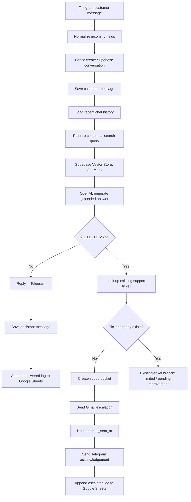

# Telecom AI Customer Support Assistant

**AI-powered customer support automation using n8n, Telegram, OpenAI, Supabase (PostgreSQL + pgvector), Gmail, and Google Sheets.**

> **Project status:** Functional prototype demonstrated through end-to-end scenarios. This repository documents the implementation and known limitations; it is **not presented as a production-hardened deployment**.
>
> **Knowledge-base note:** The current demonstration uses the *Wasla Experimental Telecom* knowledge pack. Its company details, plans, and policies are demonstration content, not verified offers from a real telecom operator. Replace them with client-approved documents before live use.

## Quick links

Replace the placeholders below with your own links when ready:

| Resource | Link |
|---|---|
| Project portfolio page | **[ADD PORTFOLIO LINK]** |
| Live demo / recorded walkthrough | **[ADD DEMO VIDEO LINK]** |
| 5-minute presentation | **[ADD PRESENTATION LINK]** |
| Technical report | **[ADD REPORT LINK]** |
| Client proposal | **[ADD CLIENT PROPOSAL LINK]** |
| Telegram bot (public demo only) | **[ADD BOT LINK — ONLY IF SAFE TO SHARE]** |

## 1. Problem statement

Telecom support teams handle repetitive questions about mobile-data packages, home internet, prices, validity, renewals, and common connection issues. Responding to every question manually increases response time and workload. Some inquiries—such as checking an individual customer's balance—cannot be answered from general company documents and require a human agent.

## 2. Proposed solution

Build a Telegram-based assistant that:

1. Receives customer messages through an **n8n Telegram Trigger**.
2. Creates or locates the conversation in **Supabase** and stores customer messages.
3. Retrieves recent conversation history for context.
4. Searches approved company documents using **retrieval-augmented generation (RAG)**.
5. Uses an **OpenAI chat model** to answer only when relevant source content is available.
6. Escalates unsupported or personal-account inquiries by creating a **support ticket** and emailing a human support contact.
7. Logs completed interactions in **Google Sheets**.
8. Routes failed production executions to a separate error-notification workflow.

A pending support ticket does **not** block the user from asking unrelated questions. Escalation is tracked at the **ticket level**, not by suspending the entire conversation.

## 3. Technology stack

| Technology | Purpose |
|---|---|
| **n8n Cloud** | Workflow orchestration and integrations |
| **Telegram Bot** | Customer-facing messaging channel |
| **OpenAI Chat Model** | Arabic-language answer generation and escalation decision |
| **OpenAI Embeddings** | Vector representations of documents and search queries |
| **Supabase PostgreSQL + pgvector** | Knowledge retrieval, conversation history, and support tickets |
| **Gmail** | Human escalation and administrator error alerts |
| **Google Sheets** | Readable interaction audit log |
| **PDF / TXT source documents** | Intended approved knowledge sources; the demonstrated ingestion configuration currently uses the text loader |

## 4. System overview



> The diagram describes the implemented routing and its limitation: the existing-ticket branch does not yet implement full safe retry/resume behavior. The separate error workflow is explained below.

### Architecture image placeholder

<!-- Upload your image to assets/screenshots/system-architecture.png, then uncomment the next line. -->
<!--  -->

**[ADD SYSTEM ARCHITECTURE IMAGE HERE]**

## 5. The three n8n workflows

The exported, publication-safe JSON files are stored in the **[`Workflow/`](Workflow/)** directory of this project.

### Workflow 01 — Knowledge Base Ingestion

**File:** [`01-knowledge-base.json`](Workflow/01-knowledge-base.json)

**Nodes (5):** Form Trigger → Supabase Vector Store, with OpenAI Embeddings, Default Data Loader, and Recursive Character Text Splitter connected as AI sub-nodes.

**Purpose:** Upload approved text material, split it into smaller chunks, create embeddings, and store the chunks in the `documents` table. The ingestion test stored **26 chunks** of the Wasla knowledge pack.

**Input:** Uploaded document through a protected n8n form. **Output:** searchable records in Supabase.

**Important:** The exported Data Loader uses a **text loader**. Although the form description mentions PDF/TXT, PDF ingestion has not been verified with this loader configuration. Use a tested PDF extraction path before promising PDF support.

**Screenshot placeholder:** **[ADD WORKFLOW 01 SCREENSHOT HERE]**

<!--  -->

### Workflow 02 — Customer Support

**File:** [`02-customer-support.json`](Workflow/02-customer-support.json)

**Nodes (28):** Telegram intake, field normalization, conversation lookup/creation, message persistence, short conversation history, context-aware query preparation, vector search, OpenAI response generation, answer/escalation routing, Gmail, support-ticket tracking, Telegram replies, and Google Sheets logging.

**Normal answer branch:** Telegram → RAG → OpenAI → Telegram reply → save assistant message → Google Sheets.

**Human escalation branch:** OpenAI returns `NEEDS_HUMAN` → search for a ticket for that Telegram message → create ticket if absent → send formatted Gmail notification → record the email-send timestamp → acknowledge in Telegram → log in Google Sheets.

**Screenshot placeholder:** **[ADD WORKFLOW 02 FULL CANVAS SCREENSHOT HERE]**

<!--  -->

### Workflow 03 — Error Handling

**File:** [`03-error-handling.json`](Workflow/03-error-handling.json)

**Nodes (3):** Error Trigger → Edit Fields → Gmail.

**Purpose:** Receive a failure event from a configured n8n error workflow, prepare the failed workflow name, last executed node, error message, time, and execution URL when available, and send a formatted administrator alert.

**Validation:** A separate **Webhook → Stop And Error** test workflow was deliberately failed in production execution mode; the error alert reached Gmail with the expected failure details. The temporary test workflow should be disabled after testing.

**Screenshot placeholder:** **[ADD WORKFLOW 03 SCREENSHOT HERE]**

<!--  -->

## 6. Supabase database design

| Table | Key fields | Usage |
|---|---|---|
| `documents` | `id`, `content`, `metadata`, `embedding` | RAG knowledge chunks and vector embeddings |
| `conversations` | `id`, `telegram_chat_id`, `customer_name`, `status`, timestamps | One conversation record per Telegram chat |
| `messages` | `id`, `conversation_id`, `telegram_message_id`, `sender`, `content`, `created_at` | Customer/assistant history |
| `support_tickets` | `id`, `conversation_id`, `telegram_message_id`, `customer_message`, `status`, `email_sent_at`, timestamps | Human-support requests and email status |

**Relations:** `messages.conversation_id` and `support_tickets.conversation_id` reference `conversations.id`. Knowledge records in `documents` are separate from personal conversations. Row-level security (RLS) was enabled on the project tables; server credentials and access policies must be reviewed before production deployment.

**Embedding design:** OpenAI `text-embedding-3-small` with the default **1536 dimensions**; vector similarity search is provided through Supabase/pgvector and the `match_documents` database function.

### Database screenshots

- **[ADD SUPABASE TABLES / SCHEMA SCREENSHOT]**
- **[ADD VECTOR SEARCH / DOCUMENTS SCREENSHOT]**
- **[ADD SUPPORT TICKET EXAMPLE SCREENSHOT — REDACT PERSONAL DATA]**

## 7. How RAG and conversation context work

The bot does not generate product details solely from pretrained model knowledge. It searches the vector store for relevant chunks and supplies those chunks to the chat model as `context`.

Recent stored messages (configured at **16** in the export) are assembled into `history`. The query-preparation JavaScript adds context from the previous customer question when a new question looks like a follow-up. This helped answer a renewal follow-up that did not repeat the package name.

**Important limitation:** The rule-based follow-up detector may fail for topic changes, ambiguous references, or long chats. Retrieval quality should be evaluated beyond the demonstrated cases.

## 8. Human escalation logic

Escalation happens when a question cannot be answered reliably from approved knowledge, requires customer-specific account data, or explicitly requests a human agent. The configured prompt asks the model to output exactly:

```text
NEEDS_HUMAN
```

The n8n IF node sends that result down the escalation route. Tickets are recorded in `support_tickets` with `pending` status. Gmail sends an HTML message, and a later Supabase node updates `email_sent_at` when the send operation succeeds. Customers can continue to ask unrelated service questions afterward.

**Caution:** Model-produced text is not a perfect safety boundary. The current decision uses an exact text match; additional verification of unsupported or malformed model output remains a production improvement.

## 9. Tested scenarios and evidence

The following scenarios were demonstrated during development. Add dated test records and screenshots in `tests/testing-evidence.md` to document the final published version.

| ID | Scenario | Observed result |
|---|---|---|
| T01 | Ask the price and validity of M15 | Correct answer from approved demonstration knowledge |
| T02 | Ask a follow-up about automatic renewal | After improving query context, the assistant answered without unnecessary escalation |
| T03 | Request personal balance information | Routed to human support using `NEEDS_HUMAN` |
| T04 | Human escalation | Support ticket created; Gmail alert and Telegram acknowledgement observed |
| T05 | Ask about M30 with an open support ticket | Assistant still answered the new general question |
| T06 | Intentional execution error | Error Handling workflow delivered an HTML Gmail alert |

These are **observations from specific tests**, not measured reliability or a service-level guarantee. No automated performance, load, security, or full retry-suite results are claimed.

### Screenshots and proof links

| Evidence | Add your link or image |
|---|---|
| Answer from Telegram (M15) | **[ADD SCREENSHOT/LINK]** |
| Follow-up context / memory | **[ADD SCREENSHOT/LINK]** |
| Human escalation email | **[ADD SCREENSHOT/LINK]** |
| Support ticket in Supabase | **[ADD SCREENSHOT/LINK]** |
| Google Sheets log | **[ADD SCREENSHOT/LINK]** |
| Error alert email | **[ADD SCREENSHOT/LINK]** |
| n8n execution history | **[ADD SCREENSHOT/LINK]** |

## 10. Setup and reproduction

> These exports are **templates/configuration examples**, not an immediately deployable hosted service. You must bring your own accounts, approved documents, database setup, and credentials.

1. Create a Supabase project; enable the `vector` extension (`pgvector`).
2. Create the `documents`, `conversations`, `messages`, and `support_tickets` tables, their relationships and appropriate access controls. Configure the compatible `match_documents` function; match embedding dimensions to the chosen model.
3. Import the JSON files from [`Workflow/`](Workflow/) into your n8n instance.
4. Configure your **Telegram**, **Supabase**, **OpenAI**, **Gmail**, and **Google Sheets** credentials within n8n. Do not hardcode secrets in nodes or commit them to GitHub.
5. Create a Google Sheet with the columns `Timestamp`, `Chat_ID`, `Customer_Name`, `Customer_Message`, `AI_Response`, `Status`, and `Escalated_to_Human`; update the relevant n8n document/sheet selections.
6. Upload and validate approved text knowledge using Workflow 01. Check that the expected embeddings and text chunks reach Supabase.
7. Configure Workflow 02's **Error Workflow** setting to point to Workflow 03.
8. Review Telegram webhook behavior and publish only the intended production workflows; avoid a second active Telegram Trigger for the same bot.
9. Test a known answer, an unknown question, escalation, follow-up context, and a safe error scenario before allowing real customers.

**Data privacy:** Never expose the Telegram bot token, service-role/secret Supabase key, OpenAI credentials, Gmail OAuth tokens, customer chat IDs, or private email addresses in public files or screenshots. Public sample data should be synthetic or redacted.

## 11. Known limitations and next improvements

- **PDF handling:** Form copy mentions PDF/TXT, but only the text-loader path is established in the exported ingestion workflow. Test and implement proper PDF parsing if required.
- **Escalation history:** The formatted Gmail escalation currently references short `history` from the conversation context (up to the configured recent-message limit), not guaranteed complete historical retrieval.
- **Existing tickets / retries:** The existing-ticket branch does not yet fully resume partially sent escalations; the database uniqueness constraint prevents duplicate ticket rows for the same message but does not solve every failure/retry case.
- **New-conversation status mapping:** The exported mapping for a newly created conversation should be reviewed and tested independently from the existing-conversation path.
- **AI validation:** `NEEDS_HUMAN` is checked by exact text comparison; structured outputs and explicit confidence/coverage checks would improve robustness.
- **Failure handling:** The error workflow sends an administrator alert but does not automatically recover the failed operation or guarantee a customer-facing fallback.
- **Security and retention:** Define least-privilege access, redaction, retention/deletion rules, and production monitoring before processing real customer data.

## 12. Repository structure

```text
telecom-ai-customer-support-project/
├── README.md
├── Workflow/                    # Existing GitHub folder (singular)
│   ├── 01-knowledge-base.json
│   ├── 02-customer-support.json
│   └── 03-error-handling.json
├── docs/                        # Create as documents become available
│   ├── client-proposal.pdf
│   ├── system-architecture.png
│   └── final-report.pdf
├── tests/
│   └── testing-evidence.md
├── assets/
│   └── screenshots/
└── demo/
    └── demo-notes.md
```

## 13. Demo and presentation

**[ADD SHORT DEMO VIDEO LINK]**  
**[ADD 5-MINUTE PRESENTATION LINK]**

Suggested 5-minute outline (planned, not yet a delivered presentation):

| Time | Content |
|---|---|
| 0:00–0:40 | Customer support problem and target users |
| 0:40–1:25 | Proposed solution and architecture |
| 1:25–2:15 | Knowledge ingestion and RAG search |
| 2:15–3:20 | Live Telegram demo, memory, and human escalation |
| 3:20–4:15 | Supabase, Google Sheets, and error alerting |
| 4:15–5:00 | Test results, limitations, and next steps |

## 14. Author and contact

**Project:** Telecom AI Customer Support Assistant  
**Author:** **[ADD YOUR PREFERRED DISPLAY NAME]**  
**Portfolio:** **[ADD YOUR PORTFOLIO LINK]**  
**LinkedIn:** **[ADD LINKEDIN LINK]**  
**Contact:** **[ADD PUBLIC PROFESSIONAL CONTACT LINK — OPTIONAL]**

---

**Built as a documented AI automation project with human-in-the-loop escalation and grounded knowledge retrieval.**
