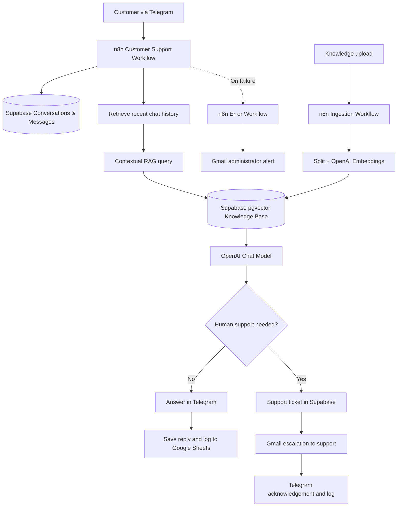

# 📡 Telecom AI Customer Support Assistant

**An AI-powered, Telegram-based customer support prototype for a fictional telecom provider in Palestine.**

[](https://github.com/deemaredwan-a11y/Deema-portfolio-Ai-Automation/tree/main/telecom-ai-customer-support-project)


> **Scope:** A tested educational/capstone prototype, **not a production-ready telecom deployment**. The knowledge base uses fictional **Wasla Experimental Telecom** packages and policies; prices and offers are illustrative, not official offers from Jawwal or another real operator.

## 🔗 Quick links

**Repository:** [Telecom AI Customer Support Project](https://github.com/deemaredwan-a11y/Deema-portfolio-Ai-Automation/tree/main/telecom-ai-customer-support-project)  
**Automation files:** [n8n Workflows](Workflow/)  
**Client proposal:**· [Markdown](docs/client-proposal.md)  
**System architecture:** [View diagram](https://github.com/deemaredwan-a11y/Deema-portfolio-Ai-Automation/blob/main/telecom-ai-customer-support-project/docs/telecom-system-architecture%20(1).png)  
**Final report:** [Markdown](docs/final-report.md)  
**Test evidence:** [Testing report](tests/testing-evidence.md)  
**Brand brief:** [Mini brand brief](content/brand-brief.md)  
**Prompt engineering:** [Prompts and improvements](content/prompts.md)  
**Main content:** [Social carousel assets](content/main-content/)  
**Supporting content:** [Supporting assets](content/supporting-content/)  
**Recorded system demo:** Coming soon — video not yet uploaded.  
**AI-generated marketing video:** Coming soon — not yet uploaded.  
**Final pitch slides:** Coming soon — presentation not yet uploaded.

> Links above use paths relative to this README. A link will work on GitHub **once the corresponding file has been uploaded at that exact path**. Folder links require the folders to exist. Video and slide links are deliberately not invented.

## 🎯 1. Business problem

Telecom support teams repeatedly answer questions about mobile data plans, home internet speeds, prices, package validity, and renewals. Manual responses take staff time, while some customer requests (for example, personal account balances) cannot safely be answered using generic FAQ material.

**Project objective:** Provide quick, grounded responses to routine questions and route unsupported or account-specific requests to human support, while retaining interaction records.

## 💡 2. Implemented solution

A customer sends a message to the **Telegram Bot**. **n8n Cloud** looks up the conversation in **Supabase**, saves the incoming message, loads recent history, searches approved knowledge via **RAG**, and asks an **OpenAI** chat model for an answer. The system then:

- **Answers** in Telegram and saves the reply if the information is supported by the retrieved knowledge.
- **Escalates** to human support through a Supabase ticket and Gmail notification when the request needs a person or is outside the available knowledge.
- **Logs** the interaction to Google Sheets.
- **Alerts** an administrator by Gmail when a linked n8n workflow fails.

A pending ticket does not intentionally prevent the customer from asking unrelated questions.

## 🧰 3. Technology stack

| Technology | Purpose |
| --- | --- |
| **n8n Cloud** | Workflow orchestration, routing, error-handling integration |
| **Telegram Bot** | Customer-facing messaging channel |
| **OpenAI GPT-4o mini** | Grounded Arabic response generation and escalation signal |
| **OpenAI text-embedding-3-small** | Document/query embeddings (1536 dimensions) |
| **Supabase PostgreSQL + pgvector** | Vector knowledge base, message history, conversations and tickets |
| **Gmail** | Human support escalation and administrator alerts |
| **Google Sheets** | Customer interaction logs |
| **TXT documents** | Demonstrated knowledge ingestion source (PDF not yet validated) |

## 🏗️ 4. System architecture

[**View architecture diagram**](docs/system-architecture.png)



## 🔄 5. The three n8n workflows

### Workflow 01 — Knowledge Base Ingestion

**[Download JSON](Workflow/01-knowledge-base.json)**

Accepts a document through an n8n form, loads text, splits it into chunks, creates OpenAI embeddings, and inserts the result into Supabase Vector Store. The experimental Wasla text knowledge base was ingested successfully (26 stored chunks in the recorded test).

**Important:** This implementation was validated for TXT/text loading; PDF extraction was **not** confirmed.

### Workflow 02 — Customer Support

**[Download JSON](Workflow/02-customer-support.json)**

Receives Telegram messages, finds or creates a conversation, stores messages, retrieves recent history, prepares a contextual vector query, retrieves relevant documents, and uses an LLM to produce an answer. A deterministic n8n branch checks for the exact escalation marker `NEEDS_HUMAN`.

- **Answer branch:** Telegram reply → Supabase assistant message → Google Sheets answered log.
- **Escalation branch:** Check ticket → create ticket if required → send Gmail → record email timestamp → Telegram acknowledgement → Google Sheets escalated log.

The duplicate/existing-ticket retry path has known limitations (see below).

### Workflow 03 — Error Handling

**[Download JSON](Workflow/03-error-handling.json)**

Uses n8n's Error Trigger, prepares failure details, and sends an HTML Gmail alert to the administrator. The alert was verified with an intentional test-workflow error. The error workflow is a notifier, not an automatic recovery mechanism.

## 🗃️ 6. Database overview

| Table | Role |
| --- | --- |
| `documents` | Approved text chunks, metadata, and vector embeddings |
| `conversations` | Telegram chat records and conversation status |
| `messages` | Customer and assistant message history |
| `support_tickets` | Escalation requests, status, and email-send tracking |

`messages` and `support_tickets` reference a parent `conversations` record. The vector search uses Supabase pgvector and a matching document-search function.

## 🧠 7. Prompting and responsible AI

The LLM is instructed to use retrieved company knowledge, avoid inventing telecom product information, and return exactly `NEEDS_HUMAN` when an answer requires unsupported or personal-account data. Recent conversation history helps interpret follow-up messages.

Detailed prompts, retrieval behavior, and **Before → Issue → After → Impact** improvements are documented in **[content/prompts.md](content/prompts.md)**.

**Human-in-the-loop principle:** The AI explains known services, but requests involving personal customer records or unavailable policies should be transferred to staff rather than guessed.

## ✅ 8. Demonstrated test scenarios

| Scenario | Observed outcome |
| --- | --- |
| Ask about **M15** | Correct response using demonstration knowledge (15GB, 45 ILS, 30 days) |
| Ask whether the package renews automatically | Contextual follow-up understood and answered |
| Ask for an individual customer's balance | Human escalation requested instead of invented account information |
| Human escalation | Ticket stored, Gmail sent, Telegram acknowledgement observed |
| Ask about a different package with an open ticket | Separate general question still answered |
| Google Sheets logging | Interaction rows recorded |
| Intentional n8n error | Administrator Gmail alert delivered |

For screenshots and the full test record, see **[tests/testing-evidence.md](tests/testing-evidence.md)** and **[assets/screenshots/](assets/screenshots/)**. These are specific observed tests, not a measured uptime, accuracy rate, or load-test claim.

## 🎨 9. Mini content package

The communication package introduces telecom services and the AI-powered Telegram support assistant to an audience in Palestine.

| Deliverable | Project path |
| --- | --- |
| Target audience, goals, tone and visual direction | [content/brand-brief.md](content/brand-brief.md) |
| Main social media content / carousel | [content/main-content/](content/main-content/) |
| Supporting visual or AI-generated video | [content/supporting-content/](content/supporting-content/) |
| Important prompts and iterations | [content/prompts.md](content/prompts.md) |

**Visual direction:** Green `#76BC21`, blues, turquoise, white and light gray `#F5F5F7`; modern telecom-style visuals with concise Arabic messaging.

## 💰 10. Budget estimate

The following is an **educational cost estimate**, not a vendor invoice or a commercial quote:

| Development component | Estimated hours | Cost at $2/hour |
| --- | ---: | ---: |
| Discovery and client proposal | 3 | $6 |
| Database and Supabase | 4 | $8 |
| RAG knowledge base | 5 | $10 |
| Customer support workflow | 12 | $24 |
| Error handling workflow | 3 | $6 |
| Testing and debugging | 6 | $12 |
| Documentation and delivery | 5 | $10 |
| Internet and electricity | — | $36 |
| **Total** | **38 hours** | **$112** |

**Monthly operating scenario:** 1,000 incoming messages; n8n Starter **€20/month billed annually**, Supabase Free **$0** within plan limits, and illustrative OpenAI API usage about **$0.61/month** given 2,000 input + 500 output tokens and 500 embedding tokens per message. Actual bills depend on plan, currency, usage, and whether AI is billed through n8n's managed gateway. Recurring operating costs are **not included** in the $112 development total. Revalidate provider pricing before quoting a client.

## 📂 11. Suggested project structure

```text
telecom-ai-customer-support-project/
├── README.md
├── Workflow/
│   ├── 01-knowledge-base.json
│   ├── 02-customer-support.json
│   └── 03-error-handling.json
├── docs/
│   ├── client-proposal.pdf
│   ├── client-proposal.md
│   ├── system-architecture.png
│   ├── final-report.pdf
│   └── final-report.md
├── content/
│   ├── brand-brief.md
│   ├── prompts.md
│   ├── main-content/
│   └── supporting-content/
├── tests/
│   └── testing-evidence.md
├── assets/
│   └── screenshots/
└── demo/                       # Add when videos and presentation are ready
```

The structure includes intended or previously prepared deliverables. **Verify that each target exists in GitHub after uploading**; a README does not create linked files automatically.

## ⚙️ 12. Reproducing the prototype

1. Set up Supabase PostgreSQL, enable `vector` / pgvector, and create tables `documents`, `conversations`, `messages`, and `support_tickets` with appropriate relationships, vector-search function and access policies.
2. Set up a Telegram bot and the necessary Gmail, Google Sheets, OpenAI, and Supabase accounts.
3. Import the **[three n8n JSON exports](Workflow/)** and reconfigure all environment-specific IDs and credentials (the published files should be sanitized).
4. Create a Google Sheet with columns `Timestamp`, `Chat_ID`, `Customer_Name`, `Customer_Message`, `AI_Response`, `Status`, and `Escalated_to_Human`.
5. Ingest **approved TXT source content** via Workflow 01, verify vector rows, and ensure the embedding dimensions match the database configuration.
6. Link Workflow 03 in Workflow 02's n8n **Error Workflow** settings; publish the required workflows and test the Telegram Trigger.
7. Test grounded answers, follow-ups, human escalation, database records, logging and deliberate errors in a **safe test environment** before using real user data.

**Security:** Never commit bot tokens, API keys, Supabase privileged keys, OAuth credentials, unredacted personal messages, or private email addresses to a public repository.

## ⚠️ 13. Current limitations / next steps

- PDF ingestion has not been validated with the current text loader.
- The existing-ticket branch needs stronger retry/resume and duplicate-send handling.
- The RAG follow-up heuristic and model output format should be stress-tested with ambiguous questions.
- The email escalation uses recent chat history rather than guaranteed full-history export.
- Error alerts notify administrators but do not themselves retry failed operations.
- Production deployment would require security and privacy review, data retention rules, monitoring, concurrency tests, and least-privilege credential policies.
- **Recorded product demo, AI-generated marketing video, and final 5-minute pitch presentation are pending.**

## 🎥 14. Demo and final presentation

The demo and presentation are being prepared. Once published, replace these status lines with real public or unlisted links:

- **System walkthrough / Video Demo:** Coming soon.
- **AI-generated supporting marketing video:** Coming soon.
- **Final PowerPoint pitch (5 minutes + 2-minute Q&A):** Coming soon.

## 👩‍💻 Project portfolio

[**Deema — AI Automation Portfolio on GitHub**](https://github.com/deemaredwan-a11y/Deema-portfolio-Ai-Automation)

---

*Built as a documented capstone project demonstrating RAG, workflow orchestration, human escalation, testing, and responsible AI design.*
