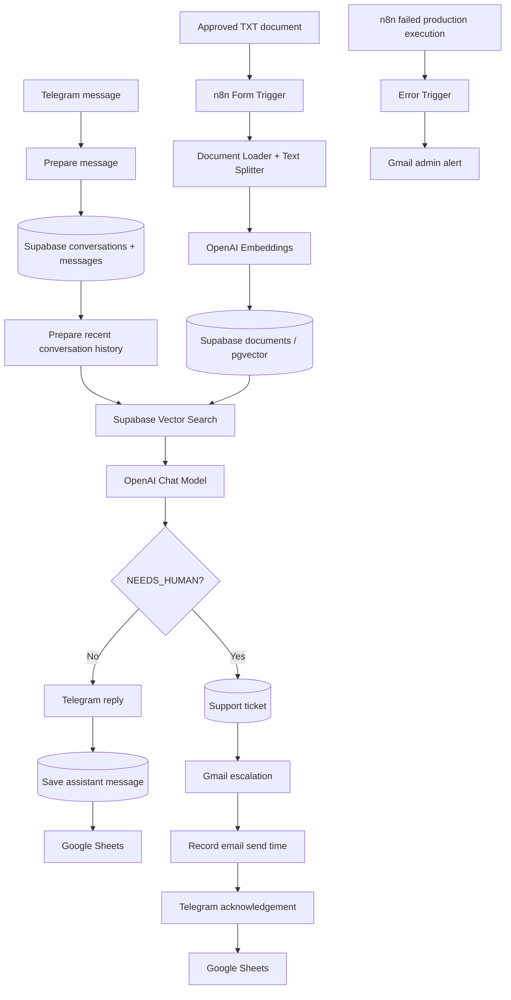

# Final Project Report
## Telecom AI Customer Support Assistant

**Project category:** AI-Powered Workflow Automation / Retrieval-Augmented Generation (RAG)  
**Implementation platform:** n8n Cloud  
**Project status:** Functional prototype; additional hardening required before production  
**Report date:** November 2026  
**Prepared by:** [deema  Redwan]  
**Repository:** [https://github.com/deemaredwan-a11y/Deema-portfolio-Ai-Automation/edit/main/telecom-ai-customer-support-project]  
**Demo video:** [ADD DEMO LINK]  
**Presentation (5 minutes):** [ADD PRESENTATION LINK]

> **Scope and evidence:** This report describes the implementation represented by the exported n8n workflow files and the demonstrations recorded during project development. The knowledge base uses the **Wasla Experimental Telecom** content pack, not verified commercial data from an operating telecom provider. Observed functional tests do not establish production reliability.

---

## 1. Executive Summary

Telecom support teams frequently receive repetitive questions about data packages, prices, plan validity, renewal rules, and connection issues. Answering every request manually creates unnecessary workload and can delay responses. At the same time, questions requiring personal account information or employee authorization must not be answered by guessing.

This project implements a Telegram-based customer support assistant using **n8n Cloud**, **OpenAI**, **Supabase PostgreSQL with pgvector**, **Gmail**, and **Google Sheets**. It searches a controlled document knowledge base before generating an answer, retains recent conversation context, and creates a support ticket when the request requires human assistance. An independent error-handling workflow alerts an administrator to failed executions.

The prototype demonstrated direct answers, context-aware follow-up answers, support-ticket creation, Gmail escalation, continued answering after an unrelated ticket was opened, and automated error notifications. Some reliability, privacy, and full-history handoff requirements remain open for production deployment.

## 2. Problem Definition

### Problem Statement

Manual handling of repetitive telecom support inquiries can slow customer service, increase workload, and make consistent answers harder to maintain—particularly outside staffed hours.

### Target Users

- Existing and prospective telecom customers seeking general service information.
- Customer-support employees handling account-specific or unresolved inquiries.
- Administrators maintaining the knowledge base and monitoring automation failures.

### Current Challenges

- Repeated questions and inconsistent manual responses.
- Company information distributed across documents rather than a searchable support channel.
- Customer follow-up messages that depend on previous conversation context.
- Requests for personal-account information that cannot be answered from public documentation.
- Operational failures that need prompt investigation.

### Expected Value

Faster access to approved information, fewer repetitive support tasks, more consistent answers, and structured handoff of unsupported inquiries. **No quantitative improvement in response time, staffing effort, or resolution rate has yet been measured against a baseline.**

## 3. Project Scope and Requirements

**Implemented in the demonstrated prototype:**

- Telegram as the customer messaging channel.
- Upload of a TXT knowledge document through an n8n Form Trigger.
- Vector search in Supabase with OpenAI embeddings.
- Arabic customer answers based on retrieved knowledge.
- Short conversational history stored and retrieved from Supabase.
- `NEEDS_HUMAN` escalation decision and ticket-level handoff through Gmail.
- Customer notification through Telegram and interaction logging in Google Sheets.
- Automated alerting for failed n8n executions.

**Out of scope or not fully completed:** real account-balance lookups, employee CRM interface, automatic human resolution, guaranteed exactly-once delivery, and a verified full-transcript handoff for arbitrarily long conversations.

**Design change from the initial proposal:** the proposal considered a website or WhatsApp channel; the implemented prototype uses **Telegram**. Human escalation is sent by **Gmail**. The implementation decision should be considered the final demonstrated channel choice.

## 4. Architecture and Technology Choices

| Component | Role | Rationale |
|---|---|---|
| n8n Cloud | Orchestrate triggers, decisions, integrations, and notifications | Visual, modular workflow automation |
| Telegram Bot | Customer-facing messaging | Simple integration and repeatable testing |
| Supabase PostgreSQL | Conversations, messages, and support tickets | Relational storage and referential integrity |
| Supabase pgvector | Document chunks and semantic search | Retrieval across approved text without hard-coded FAQ matching |
| OpenAI Embeddings | Convert queries and content to vectors | Supports semantic similarity search |
| OpenAI Chat Model | Generate grounded Arabic responses | Handles natural language and follow-up context |
| Gmail | Human escalation and administrative alerts | Existing email-based handoff channel |
| Google Sheets | Reviewable interaction log | Accessible operational record of outcomes |

### High-Level Flow

**Architecture image:** `` (upload the file to `docs/` if not already present).

## 5. Workflow 01 — Knowledge Base Ingestion

**Export:** [`../Workflow/01-knowledge-base.json`](../Workflow/01-knowledge-base.json)

**Purpose:** Load authorized company reference material into the searchable vector database.

| Node | Responsibility |
|---|---|
| On form submission | Receives the uploaded document via a protected form configuration |
| Default Data Loader | Reads the uploaded binary TXT content |
| Recursive Character Text Splitter | Splits content into overlapping chunks; configured overlap: 200 characters |
| Embeddings OpenAI | Converts text chunks into embeddings |
| Supabase Vector Store | Inserts chunks, metadata, and embeddings into `documents` |

**Observed outcome:** A TXT source document was ingested, and **26 records** appeared in the `documents` table. Search results subsequently returned source passages about the M15 package.

**Important limitation:** PDF upload is mentioned in the form description, but the exported loader is configured for text input. PDF ingestion must be separately configured and tested before claiming PDF support.

## 6. Workflow 02 — Customer Support

**Export:** [`../Workflow/02-customer-support.json`](../Workflow/02-customer-support.json)

### 6.1 Intake and Conversation Storage

1. **Telegram Trigger** receives a new message.
2. **Edit Fields** extracts `chat_id`, `message_id`, customer name, and question.
3. **Get many rows** looks up `conversations.telegram_chat_id`.
4. **Conversation Exists?** selects an existing conversation or creates a new one.
5. **Existing Conversation / Create a row / New Conversation / Prepare Conversation** normalize the conversation ID and message fields.
6. **Check Conversation Status** checks that a conversation identifier exists. The current design does not suspend all new questions after an unrelated support ticket is opened.
7. **Save Customer Message** inserts the customer's message into `messages`.

### 6.2 Memory, Retrieval, and Response

8. **Get Conversation History** retrieves up to 16 recent messages for the current conversation.
9. **Prepare Chat History** formats the sequence and constructs a search query using previous customer questions when the new message looks like a follow-up.
10. **Supabase Vector Store + Embeddings OpenAI** retrieve similar document chunks.
11. **Code in JavaScript** combines retrieved passages, question, and history into a single item.
12. **Basic LLM Chain + OpenAI Chat Model** generate an Arabic response under instructions to avoid unsupported answers or account-specific claims.
13. **IF** routes the literal `NEEDS_HUMAN` marker to escalation; otherwise, the response is sent by Telegram.

### 6.3 Answer Path

`Telegram answer → Save Assistant Message (Supabase messages) → Google Sheets log`

### 6.4 Human Handoff Path

`Find Existing Ticket → Ticket Exists? → Save Support Ticket (if new) → Gmail → Update Support Ticket → Telegram acknowledgement → Google Sheets log`

Tickets are tracked separately from conversation state so a customer may continue asking unrelated general questions while a ticket remains pending.

**Handoff limitation:** The Gmail template uses the `history` passed from the short-memory flow. It therefore does **not** guarantee the full conversation transcript for longer threads.

**Retry limitation:** The exported existing-ticket branch does not implement a complete retry strategy for a saved ticket whose Gmail delivery failed or whose send timestamp could not be updated.

## 7. Workflow 03 — Error Handling

**Export:** [`../Workflow/03-error-handling.json`](../Workflow/03-error-handling.json)

This workflow is selected as the **Error Workflow** for Workflow 02. It contains three nodes:

| Node | Responsibility |
|---|---|
| Error Trigger | Receives failed workflow execution details |
| Edit Fields | Extracts workflow name, failing node, message, execution URL, and alert timestamp |
| Gmail — Send a message | Emails an HTML-formatted failure notification to the administrator |

**Observed outcome:** A separate test workflow (`Webhook → Stop And Error`) generated an intentional production execution failure. The error workflow sent an HTML email displaying the test workflow name, `Stop and Error` node, error message, timestamp, and execution link.

**Limitation:** Alerting reports errors; it does not repair the failed workflow or guarantee a customer-visible fallback response.

## 8. Supabase Database Design

| Table | Main fields | Responsibility |
|---|---|---|
| `documents` | `id`, `content`, `metadata`, `embedding` | RAG knowledge chunks and semantic vectors |
| `conversations` | `id`, `telegram_chat_id`, `customer_name`, `status`, timestamps | Identifies customer conversation records |
| `messages` | `id`, `conversation_id`, `telegram_message_id`, `sender`, `content`, `created_at` | Stores customer and assistant history |
| `support_tickets` | `id`, `conversation_id`, `telegram_message_id`, `customer_message`, `status`, `email_sent_at`, timestamps | Tracks individual human-support requests |

`messages.conversation_id` and `support_tickets.conversation_id` reference `conversations.id`. The knowledge table is queried separately. A per-conversation Telegram message constraint supports duplicate detection; the support-ticket table also has a uniqueness constraint on `(conversation_id, telegram_message_id)`.

**Security configuration:** Row Level Security (RLS) was enabled for the tables during setup. Back-end credentials must remain in the n8n credential manager; publishing workflow exports should omit connection IDs and personal destinations. RLS alone does not restrict highly privileged server keys, so service-level access must still be reviewed.

## 9. Testing and Evidence

Full case notes and screenshot references: [`../tests/testing-evidence.md`](../tests/testing-evidence.md).

| Test area | Observed result | Status |
|---|---|---|
| TXT document ingestion | 26 knowledge chunks saved in Supabase | Observed pass |
| Direct FAQ question | M15 answered with 15 GB, 45 ILS, and validity rules | Observed pass |
| Contextual follow-up | Renewal question answered in context of M15 after search-query refinement | Observed pass |
| Personal account inquiry | Unsupported balance inquiry routed to human assistance | Observed pass |
| Ticket persistence | Ticket stored with `pending` status and populated `email_sent_at` | Observed pass |
| Post-escalation interaction | M30 question answered after an unrelated open ticket | Observed pass |
| Google Sheets logging | Answered and escalated scenarios logged in tests | Observed pass |
| Error notification | Intentional failure produced a formatted Gmail alert | Observed pass |
| Duplicate/retry behavior under failure | Not fully demonstrated | Not fully verified |
| Long conversation complete handoff | Not fully demonstrated | Not fully verified |
| PDF ingestion | Not tested in the exported text-loader configuration | Not verified |
| Multi-customer concurrency and load | No systematic load test | Not verified |

**Evidence gallery:** [ADD SCREENSHOT GALLERY LINK]  
**Recorded n8n executions:** [ADD VERIFIED EXECUTION LINKS OR OMIT IF PRIVATE]

## 10. AI Prompt Engineering and Responsible AI

The assistant prompt instructs the model to answer only from retrieved company information, use conversation context for follow-up questions, avoid guessing about unavailable account information, and emit `NEEDS_HUMAN` for unresolved or employee-requested cases.

During testing, one initial response included an explanation *alongside* `NEEDS_HUMAN`; the prompt was adjusted so the token could be routed more consistently. Another follow-up question initially escalated because retrieval lacked enough context; the search-query preparation step was refined and a subsequent test succeeded.

Responsible-use priorities:

- Do not treat retrieved document text or customer messages as instructions that override system rules.
- Avoid requesting passwords, OTPs, or payment secrets.
- Limit personal data in Gmail notifications, screenshots, and public logs.
- Maintain a human escalation path for account-specific or unsupported requests.
- Measure unsupported-answer rates and test confidence/routing before production.
- Clearly label the demonstration knowledge pack as non-authoritative for real customers.

## 11. Reliability Gaps and Next Actions

**Before a live customer deployment:**

1. Implement safe retries for tickets created before Gmail failure, including idempotent send attempts and consistent `email_sent_at` handling.
2. Retrieve and redact the **complete** transcript specifically for human handoff, without sending entire histories into every LLM request.
3. Review handling of repeated content versus repeated Telegram message IDs, and overlapping concurrent executions.
4. Add tested failure pathways for Telegram, Supabase, Gmail, and Google Sheets, including customer-visible recovery where appropriate.
5. Validate the new-conversation branch, malformed or non-text Telegram events, and undefined status handling.
6. Establish permission scopes, key rotation, data retention/deletion policies, and access controls.
7. Verify actual PDF parsing if the upload form continues advertising PDF support.
8. Evaluate answer accuracy, escalation quality, latency, and operational cost on a wider test set.

These are documented limitations rather than completed capabilities.

## 12. Reproduction and Deployment Notes

1. Create a Supabase project and configure PostgreSQL, `pgvector`, the four required tables, vector dimensions, and a `match_documents` search function.
2. Configure Telegram bot, Gmail, Google Sheets, and OpenAI credentials within n8n. Do not include tokens in exports or a public repository.
3. Import the three workflow JSON exports from `Workflow/` and rebind credentials, table references, destination mailbox, and spreadsheet.
4. Upload **approved** TXT source material and validate retrieval before allowing customer messages.
5. Attach `03 — Error Handling` under the Customer Support workflow's **Error Workflow** setting.
6. Execute a controlled test plan and verify live production-trigger behavior before considering broader use.
7. Remove or disable intentionally failing test webhooks and redact all screenshot evidence.

The exported workflows are implementation references, not guaranteed one-click deployment packages. Review instance-specific references and settings before re-use.

## 13. Deliverables and Links

| Deliverable | Location / URL |
|---|---|
| Client proposal | [`client-proposal.md`](client-proposal.md) or [https://www.upwork.com/freelance-jobs/apply/Support-Chatbot-Developer-n8n-RAG-Knowledge-Base-for-WhatsApp-Website_~022109719195596113872/?utm_source=chatgpt.com] |
| Architecture diagram | [`system-architecture.png`](system-architecture.png) |
| Workflow exports | [`../Workflow/`](../Workflow/) |
| Testing evidence | [`../tests/testing-evidence.md`](../tests/testing-evidence.md) |
| Prompt documentation | [`../content/prompts.md`](../content/prompts.md) |
| Recorded demo | [ADD DEMO VIDEO LINK] |
| Five-minute pitch | [ADD SLIDES LINK] |
| Repository / portfolio | [https://github.com/deemaredwan-a11y/Deema-portfolio-Ai-Automation/edit/main/telecom-ai-customer-support-project] |

### Screenshot placeholders

- **[ADD Screenshot: Complete Customer Support Canvas]**
- **[ADD Screenshot: Supabase `documents` table]**
- **[ADD Screenshot: Telegram direct answer + follow-up]**
- **[ADD Screenshot: Support ticket + Gmail handoff]**
- **[ADD Screenshot: Error Handler execution + notification]**

## 14. Conclusion

This project demonstrates a functioning modular AI support automation integrating RAG retrieval, Telegram messaging, persistent conversation history, ticket-level human escalation, Google Sheets reporting, and administrative error alerts. The observed demonstrations validate the core workflow under selected scenarios. The next engineering priority is **robustness**, especially full-history handoff, idempotent retries, security review, and additional tests before any real customer launch.

